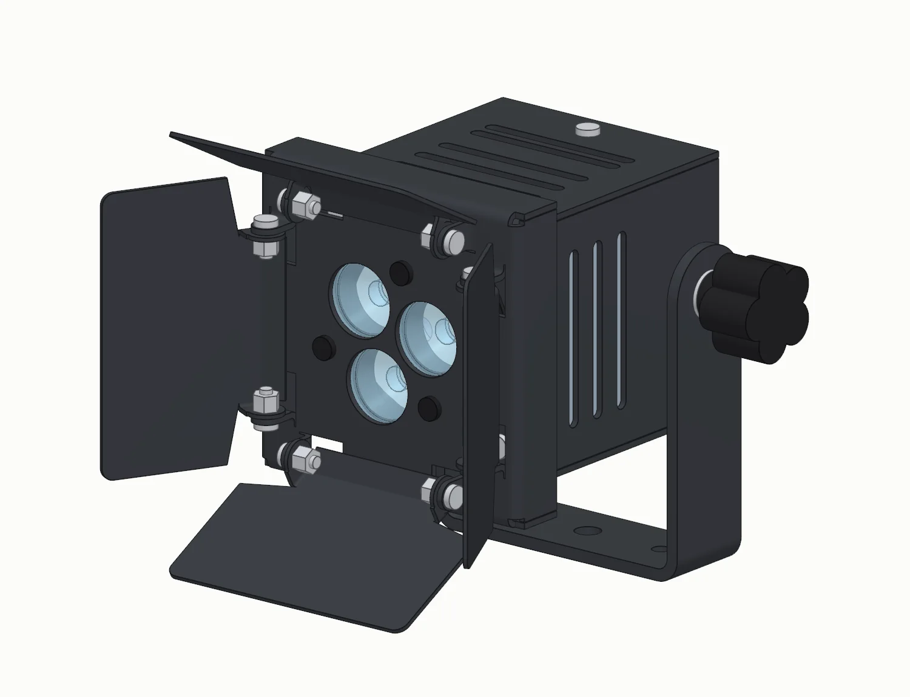
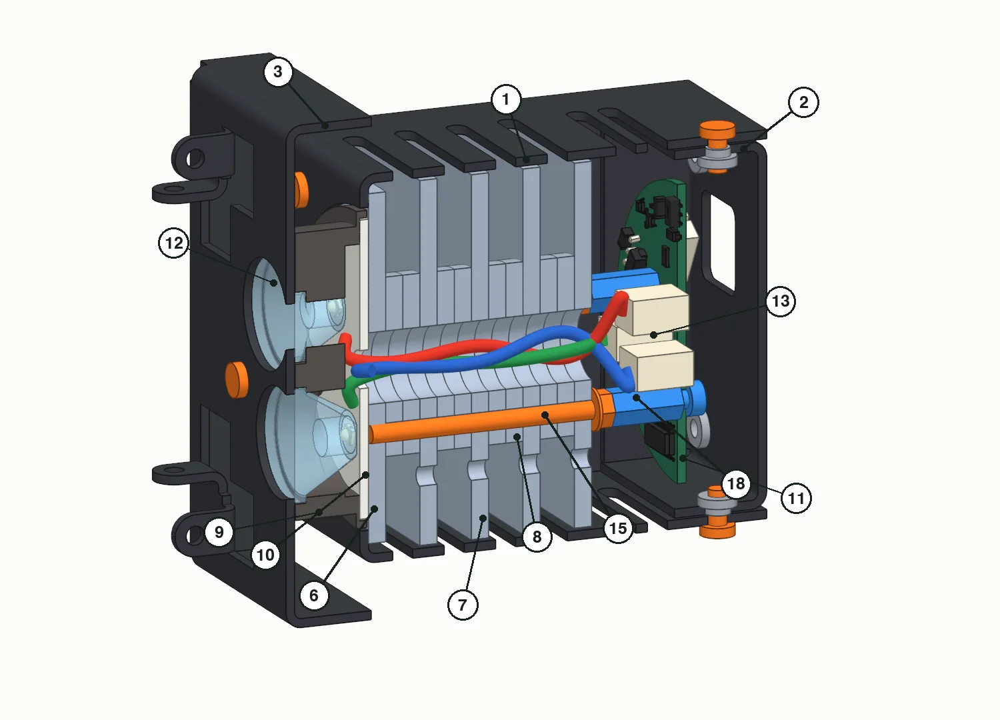
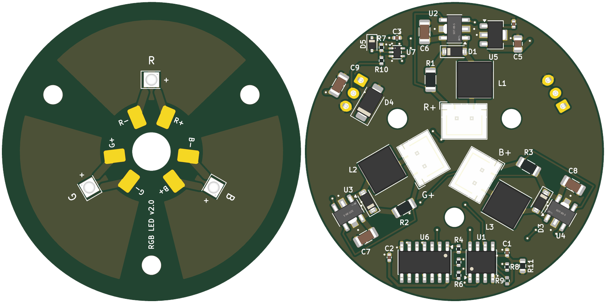
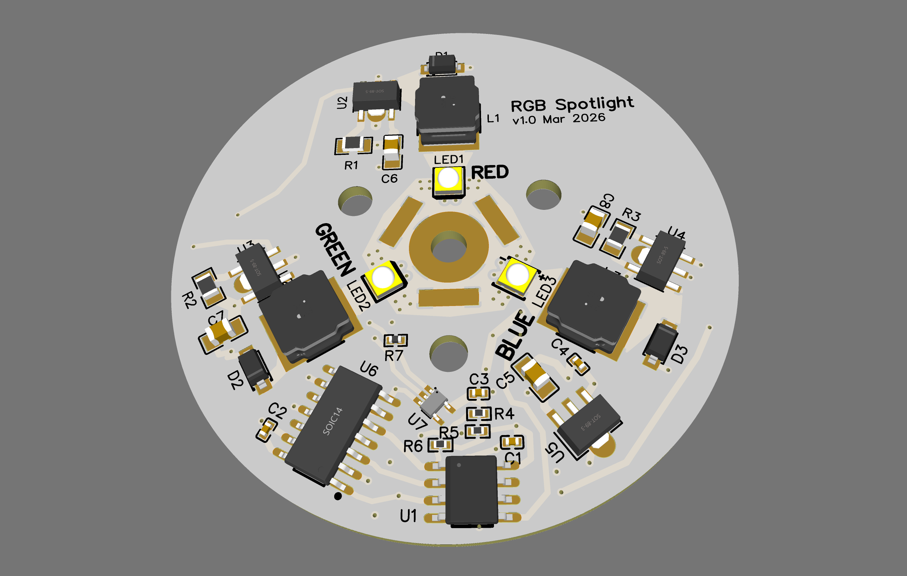

# RGB Spotlight

Status (2026-11-19): designed and released, not built yet. The driver is released as v2.4, the LED board as v2.0, a second LED board for 3.5 mm LEDs (`led35`) as v1.0, and the sheet-metal housing is in its eighth round. The first order, boards and housing for five lamps, was submitted to JLC on 2026-11-18: it is in JLC's reviews and not paid yet. The lenses were ordered on 2026-11-19. Every figure on this page is calculated or simulated; none is measured. Start with [HANDOVER.md](HANDOVER.md).

Chainable, addressable 3 x 3 W RGB spotlight for 12 V installations: three LEDs, red, green and blue, each behind its own lens, in a square aluminium housing with four barn doors, on a yoke. One lamp is one WS2811 pixel.



The pictures on this page are drawn from the design files. None is a photo.

- **v1** (EasyEDA, one FR4 board) was built but never lit: the PT4115 stages were wired as the wrong kind of buck, and the 74HC04 was unpowered.
- **v2** is a KiCad restart with two boards, an aluminium LED board and an FR4 driver board, and a housing designed around them.

| Document | What's in it |
| --- | --- |
| [HANDOVER.md](HANDOVER.md) | how we got here, decisions, the work remaining |
| [DESIGN.md](DESIGN.md) | requirements, the v1 post-mortem, numbered decisions, circuit, thermal estimate, simulation (§2.7), open items |
| [LAYOUT.md](LAYOUT.md) | the PCBs: floor plans, rules, scripted copper and routing, outline presets, checks |
| [mech/housing/](mech/housing/README.md) | the housing: sheet-metal parts, bought fasteners, assembly order, the scripts that build it and the files to order it from |
| [PRODUCTION.md](PRODUCTION.md) | order files, order checklist (polarity!), harness and bring-up, costs, the orders so far |
| [production/orders/2026-11-16-v2-first/](production/orders/2026-11-16-v2-first/ORDER.md) | the first order: the versions it pins, the parts to buy besides, its events |
| [docs/reviews/](docs/reviews/) | pre-order failure review: findings, bench list, firmware duties |
| [docs/index.html](docs/index.html) | the project's front page: what the lamp is, where it stands, links. GitHub Pages serves `docs/` at <https://somebox.github.io/rgb-spotlight/> |
| [docs/assembly/](docs/assembly/index.html) | assembly guide (HTML, open in a browser): the finished lamp, every part numbered, tools, and 14 steps with pictures drawn from the design files. Written before any part arrived: nothing in it is tried on hardware yet |

## What it does

A high-power, addressable RGB pixel for spotlights and creative lighting. It speaks the WS2811 protocol: 12 V and one data wire come in, and both go on to the next lamp.

The three colours are not mixed inside the lamp. Each LED has its own lens, 12 mm off the lamp's axis, and the colours meet on the wall. Where a door's edge cuts the beam, each colour is cut at a slightly different place, which leaves three colour bands along the shadow. That is the effect the design is after (DESIGN D8, D21–D23). How the bands look is not known until a lamp is built.

- **Optics:** three 20 mm PMMA TIR lenses, 30°, one over each LED.
  - They sit in one printed carrier (MJF PA12), and the hood clamps them by their flanges.
  - Four barn doors on the hood shape the beam, one pair at a time (D21, D22).
  - To compare, lenses of 15° and 45° and with beaded and frosted faces are ordered too, and two taller carriers to try the focus (D27).
- **Housing** ([mech/housing/](mech/housing/README.md)): sheet aluminium from JLCCNC, black powder coat.
  - A 65 mm square shell with vent slots, a back cap, an 84 mm square hood, and a yoke with two knobs.
  - About 94 mm long, 130 with the doors standing; about 0.38 kg (estimated).
  - The cap's back has two cut-outs for the connectors and four M3 threads for a box with a controller and a power supply (D31).
  - The yoke's base has one hole for a ¼ inch screw and two for M4.
- **Cooling:** passive. The LED board lies on a 3 mm aluminium plate. Behind it, eight spacers and four fins on three tie rods take the LEDs' heat to the air that passes the shell's slots.
- **LED board** (aluminium, 1 layer, 50 mm):
  - three XINGLIGHT HD2525 3 W LEDs (R/G/B), spread on a 12 mm-radius ring;
  - each LED on its own heat-spreading copper island;
  - six wire pads around a centre hole for the harness;
  - turned 45° in the housing, so each LED has its own height and its own place from left to right (D23).
- **Driver board** (FR4, 2 layers, 50 mm), on polyamide standoffs behind the fins, about 54 mm behind the LED board:
  - WS2811 pixel controller;
  - three PT4115 constant-current bucks (455 mA each);
  - level shifter on DIN, with a clamp for a feed voltage on the data pin (D28, D29, D34); Schmitt inverter for the PWM polarity;
  - 78L05 logic rail; TVS on the 12 V input.
- **Harness:** three wire pairs from the LED board through the 12 mm bore down the middle of the plate, spacers and fins, each on its own JST XH 2-pin plug (D33).
- **`led35`:** the LED board with pads for 3.5 mm LEDs, bought bare to try other colours on (D35).



The numbers are the assembly guide's part numbers: shell 1, cap 2, hood 3, plate 6, fins 7, spacers 8, carrier 9, LED board 10, driver 11, lenses 12, LED leads 13, tie studs 15, standoffs 18.



The LED board is drawn with a green mask; the ordered ones are white.

## Electrical specs

- **Supply:** 12 V (the PT4115 regulates down to about 6 V at the end of a chain)
- **Data:** WS2811 protocol, 800 kHz, single wire; 3.3 V or 5 V at DIN
- **LED current:** about 455 mA per channel (`I = 0.1 V / 0.22 Ω`); LEDs rated 1 A / 3 W
- **Full white:** 5.0 W, 0.42 A at 12 V per light (simulated, DESIGN.md §2.7); drivers about 80 % efficient
- **Chaining:** JST XH connectors (3 A) pass 12 V/GND through: up to 5 lights per 12 V feed, 2.2–2.6 A, with a 3 A fuse at the supply end (DESIGN.md §2.4, D14, D15). Use a 36 W supply for 4 lights and 60 W for 5, and add a feed per group after that.
- **Heat:** about 2.7 W in the LED board, which goes into the housing's heat plate and fins. About 0.9 W in the driver, mostly in the three Schottky diodes. See DESIGN.md §2.6–2.7.
- **Dimming:** brightness follows the 8-bit level within 5 % above 20 % and within 20 % down to 5 %. The lowest few levels are unreliable (DESIGN.md §2.7).
- **12 V on the data pin** (a mis-crimped cable): simulated with up to 15 V there, the level shifter's input stays at 5.43 V or less and the 5 V rail at 5.0 V (D28, D29). On the bench list.
- **Firmware:** FastLED's `WS2811` (800 kHz) fits the WS2811's timing. ESPHome needs its timing set by hand (the review's firmware duties). WLED hasn't been checked. None of it has run on a lamp yet.

## Connections

| Connector | Where | Pins |
| --- | --- | --- |
| J1 IN | driver, back (JST XH 3, vertical) | 1 `12V`, 2 `DATA`, 3 `GND` |
| J2 OUT | driver, back (JST XH 3, vertical) | 1 `12V`, 2 `DATA`, 3 `GND` |
| J3 / J4 / J5 LED | driver, front (JST XH 2, vertical): red, green, blue | 1 `+`, 2 `-` |
| TP1–TP6 | LED board, around the centre hole | `R+` `R-` `G+` `G-` `B+` `B-`; solder the wires here, a pair to each socket |

J1 and J2 share one pin order, so chain with pin-1-to-pin-1 cables. v1 had J2 mirrored. In the housing, both are reached through the cap's cut-outs.

1. Connect the controller's data to J1 pin 2 of the first light, and +12 V / GND to pins 1 / 3. Keep controller and power grounds common.
2. Chain J2 of one light to J1 of the next.
3. Twist each colour's LED pair in the harness.

## Project layout

- `boards/led/`, `boards/driver/`: KiCad 10 projects. Schematics come from `scripts/sch_led.py` / `scripts/sch_driver.py`; boards from `scripts/make_led_pcb.sh` / `scripts/make_driver_pcb.sh`.
- `boards/led35/`: the LED board with pads for 3.5 mm LEDs (DESIGN D35), bought bare; `scripts/sch_led.py led35` and `scripts/make_led_pcb.sh led35`.
- `lib/`: project symbols, footprints and 3D models (`scripts/make_lib.py`).
- `scripts/`: generators and checks (`netcheck.py`, `ratsnest.py`, `make_previews.sh`, `make_fab.sh`); `pcbkit.toml` sets up pcb-kit's release and production record. The shared parts (schematic builder, silkscreen placer, DRC/ERC/board checks, previews, JLC fab files, ngspice runner) come from [pcb-kit](https://github.com/somebox/pcb-kit): `uv tool install -e ~/src/pcb-kit && pcbkit link`.
- `mech/housing/`: the housing as CadQuery scripts (`sheet.py`, then `round2.py` to `round8.py`, each changing the round before), its checks, and the STEP files and drawings to order from (`order6/`, `order7/`, `order8/`). Its [README](mech/housing/README.md) has the parts, the fasteners and the rebuild commands.
- `releases/<board>/v<version>/`: a release's order files and its frozen KiCad project, written by `pcbkit release` and never rewritten.
- `production/orders/<date>-<what>/`: an order's `order.toml` and the ORDER.md that `pcbkit production` writes from it.
- `sim/`: ngspice simulations of one LED channel (`channel.py`) and of the data link between two lights (`data_cable.py`), and the review's worst-case numbers (`worst_case.py`); tables and plots in `sim/results/`.
- `docs/previews/<board>/`: schematic PDF, board PNGs, 3D renders. `docs/previews/outline-presets.png` compares the board outline options.
- `docs/assembly/`, `docs/index.html`: the assembly guide and the front page. The guide's pictures come from `mech/housing/assembly_views.py`.
- **Board outline:** everything sits in a 50 mm core. The edge is a preset, `disc50` (current, and what the housing takes), `disc55`, `disc60` or `tabs3` (screw tabs). Change it with `scripts/set_outline.py`; see LAYOUT.md.
- `archive/v1-easyeda/`: the v1 EasyEDA exports, a KiCad import of the v1 board, its as-built netlist and the bodge guide.

Checks, previews and a release:

```bash
pcbkit erc boards/driver/driver.kicad_sch && python3 scripts/netcheck.py
pcbkit drc boards/driver/driver.kicad_pcb --save && pcbkit check boards/driver/driver.kicad_pcb
scripts/make_previews.sh all
pcbkit release --dry-run                                    # then pcbkit release: versioned order files in releases/ (PRODUCTION.md)
python3 sim/channel.py                                      # LED channel simulation
```

How the boards were generated. A released board is not regenerated: change it in place (LAYOUT.md, "Regenerating").

```bash
python3 scripts/sch_driver.py && python3 scripts/sch_led.py
scripts/make_led_pcb.sh && scripts/make_driver_pcb.sh --force --route
```

## BOM

- Driver: 22 lines, about $1.80 at qty 1 (bomi, 2026-11-17). JLC assembles 21 of them, 37 placements; J1 and J2 are soldered by hand. LED board: 3 lines, about $0.79 (bomi, 2026-11-14).
- The lenses, the fasteners and the other parts bought besides the boards are listed in [PRODUCTION.md](PRODUCTION.md), "Parts for the open orders".
- Each board has its own bomi project:

```bash
bomi --project boards/driver list --check
bomi --project boards/driver list --format markdown > docs/BOM_driver.md
bomi --project boards/led list --format markdown > docs/BOM_led.md
```

See [docs/BOM_driver.md](docs/BOM_driver.md), [docs/BOM_led.md](docs/BOM_led.md) and DESIGN.md §3. The v1 rationale doc is in `archive/v1-easyeda/rgb-spotlight-bom-v1.md`; its PT4115 connection tables are wrong.

## v1 (for reference)


