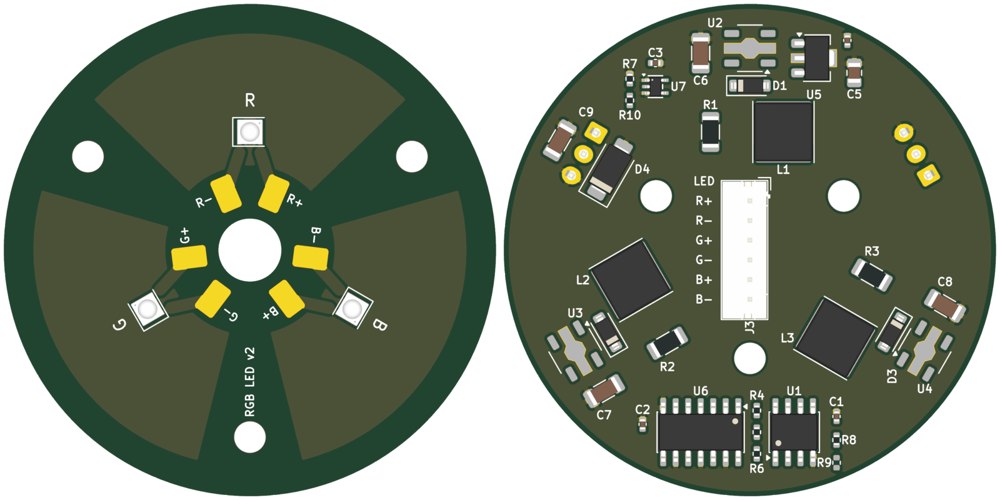
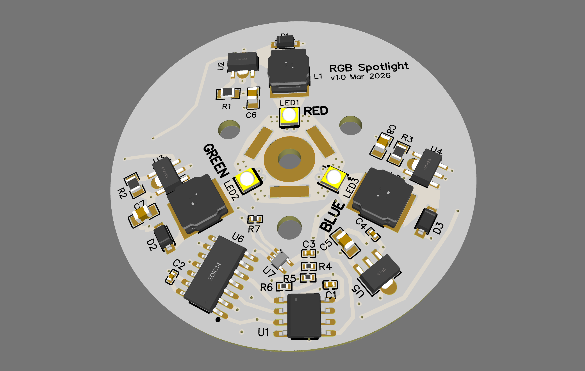

# RGB Spotlight

Status (2026-10-11): v2 schematics and both boards done (DRC clean); one LED channel simulated. Next: v1 bench tests, the housing decision, then the order.

Chainable, addressable 3 x 3 W RGB spotlight for 12 V installations: an aluminium LED board and an FR4 driver board in an aluminium cylinder.



- **v1** (EasyEDA, one FR4 board) was built but never lit: the PT4115 stages were wired as the wrong kind of buck, and the 74HC04 was unpowered.
- **v2** is a KiCad restart with two boards.

| Document | What's in it |
| --- | --- |
| [DESIGN.md](DESIGN.md) | requirements, the v1 post-mortem, numbered decisions, circuit, thermal estimate, simulation (§2.7), open items |
| [LAYOUT.md](LAYOUT.md) | both PCBs: floor plans, rules, scripted copper and routing, outline presets, checks |
| [PRODUCTION.md](PRODUCTION.md) | order files, order checklist (polarity!), harness and bring-up, costs |

## What it does

A high-power, addressable RGB pixel for spotlights and creative lighting. It speaks the WS2811 protocol, so it daisy-chains and works with FastLED, WLED and other WS2811-compatible software.

- **LED board** (aluminium, 1 layer, 50 mm):
  - three XINGLIGHT HD2525 3 W LEDs (R/G/B), spread on a 12 mm-radius ring;
  - each LED on its own heat-spreading copper island;
  - six wire pads around a centre hole for the harness.
- **Driver board** (FR4, 2 layers, 50 mm), mounted 4–6 cm behind the LED board:
  - WS2811 pixel controller;
  - three PT4115 constant-current bucks (455 mA each);
  - level shifter on DIN; inverter for the PWM polarity;
  - 78L05 logic rail; TVS on the 12 V input.

## Electrical specs

- **Supply:** 12 V (the PT4115 regulates down to about 6 V at the end of a chain)
- **Data:** WS2811 protocol, 800 kHz, single wire; 3.3 V or 5 V at DIN
- **LED current:** about 455 mA per channel (`I = 0.1 V / 0.22 Ω`); LEDs rated 1 A / 3 W
- **Full white:** 5.0 W, 0.42 A at 12 V per light (simulated, DESIGN.md §2.7); drivers about 80 % efficient
- **Chaining:** JST XH connectors (3 A) pass 12 V/GND through: up to 6 lights per power feed (2.5 A). Inject power again after that.
- **Heat:** about 2.7 W in the LED board, which needs a heatsink: the housing's heat plate. About 0.9 W in the driver, mostly in the three Schottky diodes. See DESIGN.md §2.6–2.7.
- **Dimming:** brightness follows the 8-bit level within 5 % above 20 % and within 20 % down to 5 %. The lowest few levels are unreliable (DESIGN.md §2.7).

## Connections

| Connector | Where | Pins |
| --- | --- | --- |
| J1 IN | driver, back (JST XH 3, vertical) | 1 `12V`, 2 `DATA`, 3 `GND` |
| J2 OUT | driver, back (JST XH 3, vertical) | 1 `12V`, 2 `DATA`, 3 `GND` |
| J3 LED | driver, front (JST PH 6, vertical) | 1 `R+`, 2 `R-`, 3 `G+`, 4 `G-`, 5 `B+`, 6 `B-` |
| TP1–TP6 | LED board, around the centre hole | same order as J3; solder the wires here |

J1 and J2 share one pin order, so chain with pin-1-to-pin-1 cables. v1 had J2 mirrored.

1. Connect the controller's data to J1 pin 2 of the first light, and +12 V / GND to pins 1 / 3. Keep controller and power grounds common.
2. Chain J2 of one light to J1 of the next.
3. Twist each colour's LED pair in the harness.

## Project layout

- `boards/led/`, `boards/driver/`: KiCad 10 projects. Schematics come from `scripts/sch_led.py` / `scripts/sch_driver.py`; boards from `scripts/make_led_pcb.sh` / `scripts/make_driver_pcb.sh`.
- `lib/`: project symbols, footprints and 3D models (`scripts/make_lib.py`).
- `scripts/`: generators and checks (`netcheck.py`, `ratsnest.py`, `make_previews.sh`, `make_fab.sh`); `pcbkit.toml` sets up pcb-kit's release and production record. The shared parts (schematic builder, silkscreen placer, DRC/ERC/board checks, previews, JLC fab files, ngspice runner) come from [pcb-kit](https://github.com/somebox/pcb-kit): `uv tool install -e ~/src/pcb-kit && pcbkit link`.
- `sim/`: ngspice simulation of one LED channel (`sim/channel.py`); tables and plots in `sim/results/`.
- `docs/previews/<board>/`: schematic PDF, board PNGs, 3D renders. `docs/previews/outline-presets.png` compares the board outline options.
- **Board outline:** everything sits in a 50 mm core. The edge is a preset, `disc50` (current), `disc55`, `disc60` or `tabs3` (screw tabs). Change it with `scripts/set_outline.py`; see LAYOUT.md.
- `archive/v1-easyeda/`: the v1 EasyEDA exports, a KiCad import of the v1 board, its as-built netlist and the bodge guide.

```bash
python3 scripts/sch_driver.py && python3 scripts/sch_led.py
pcbkit erc boards/driver/driver.kicad_sch && python3 scripts/netcheck.py
scripts/make_led_pcb.sh && scripts/make_driver_pcb.sh --force --route
pcbkit drc boards/driver/driver.kicad_pcb --save && pcbkit check boards/driver/driver.kicad_pcb
scripts/make_previews.sh all
pcbkit release --dry-run                                    # then pcbkit release: versioned order files in releases/ (PRODUCTION.md)
python3 sim/channel.py                                      # LED channel simulation
```

## BOM

- Driver: 19 lines, about $2.18 at qty 1. LED board: 3 lines, about $0.77 (bomi, 2026-10-05).
- Each board has its own bomi project:

```bash
bomi --project boards/driver list --check
bomi --project boards/driver list --format markdown > docs/BOM_driver.md
bomi --project boards/led list --format markdown > docs/BOM_led.md
```

See [docs/BOM_driver.md](docs/BOM_driver.md), [docs/BOM_led.md](docs/BOM_led.md) and DESIGN.md §3. The v1 rationale doc is in `archive/v1-easyeda/rgb-spotlight-bom-v1.md`; its PT4115 connection tables are wrong.

## v1 (for reference)


