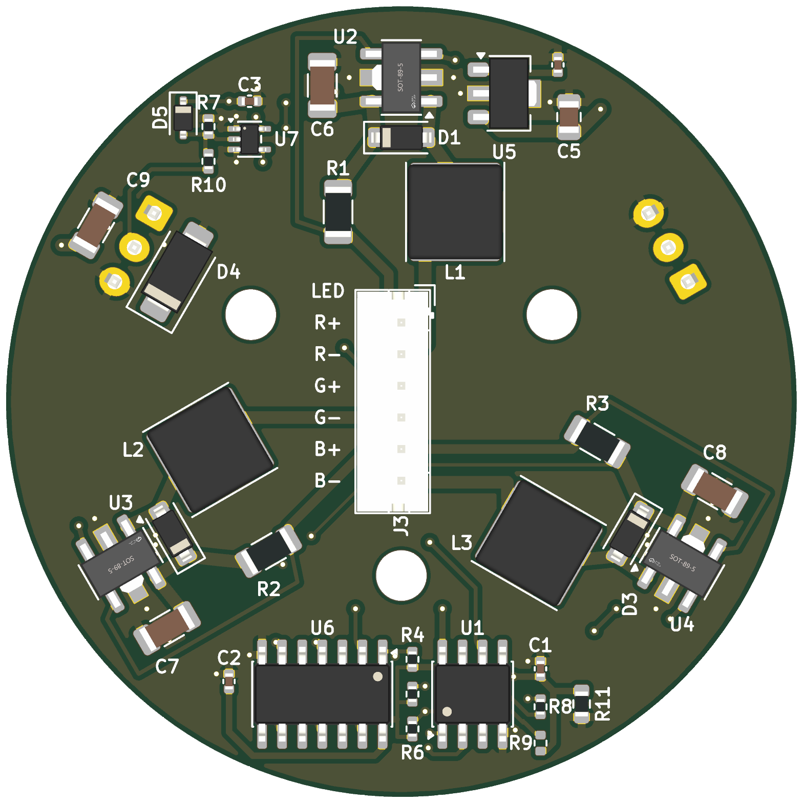
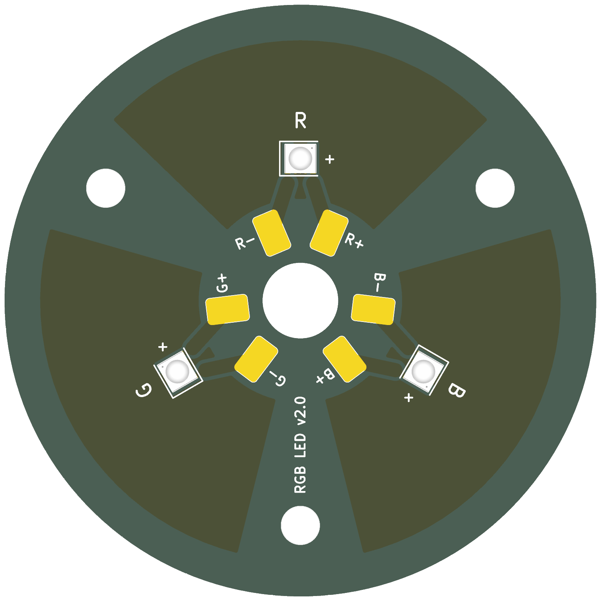

# Order 2026-11-16-v2-first: driver v2.3 and LED board v2.0, all 5 of each assembled, with the round-7 housing for 5 lamps

Generated by `pcbkit production` from [order.toml](order.toml); edit that, not this.

| PCB | version | house | PCBs | assembled | status | order no. | price | note |
| --- | --- | --- | --- | --- | --- | --- | --- | --- |
| driver | [v2.3](../../../releases/driver/v2.3) | JLCPCB | 5 | 5 | draft (2026-11-17) |  | 45.55 USD |  |
| led | [v2.0](../../../releases/led/v2.0) | JLCPCB | 5 | 5 | draft (2026-11-17) |  | 47.64 USD |  |

## Tell the fab

- LED board: aluminium, 1 layer, 1.6 mm, 1 oz, 1 W/mK (the only conductivity JLC offers on 1-layer aluminium), 3000 V, white mask, black silkscreen, HASL with lead, JLC's mark removed, single PCBs
- LED board PCBA: Standard (Economic is not offered on aluminium), top side, 5 of 5 assembled, JLC's edge rails added (the board is under 70 mm), Confirm Parts Placement yes; assembly remark: 'LED1-LED3 (HD2525): cathode = pad 1, the side away from the package dot. The + on the silk marks the anode.'
- LED board BOM: 3/3 matched by LCSC number; JLC left LED3 (blue, C49237860) unticked at quantity 0 with 'The processing of this component is difficult', reviewed after ordering and charged extra only if an advanced option is needed. Ticked by hand
- Driver: FR4, 2 layers, 1.6 mm, 1 oz, green mask, white silkscreen, HASL with lead (JLC now defaults to OSP), tented vias, JLC's default 0.3 mm via option (all 69 vias are 0.3 mm drills), JLC's mark removed. PCB remark: the JLCJLCJLCJLC text on the bottom silk is an old order-number placeholder, to be left off
- Driver PCBA: Economic, top side, 5 of 5 assembled, JLC's tooling holes, Confirm Parts Placement yes, nitrogen reflow (Economic default); files are the -front pair from `pcbkit fab` on the board as released (v2.3 from 2026-11-16) (the release's CPL less J1/J2, which sit on the back). J3-J5 (JST XH 2, through-hole, C158012) placed by JLC: hand-soldering $3.61 and manual assembly $0.53 on Y180 (5 assembled; $0.23 for 2 on Y179; v2.1's one PH 6 cost $3.61 + $0.20)
- Placement preview, checked part by part against the releases' PLACEMENT-*-jlcpcb.md: U2-U5 (^SOT-89, never checked before), U1/U6 (SOIC), D1-D4 right, and D5 (v2.1, D_SOD-323, no rule) right. Turned by hand: U7 (74AHCT1G125, C350557) one Rotate Left on v2.0, v2.1 and v2.3, as the never-checked ^SOT-353 (+180) left it a quarter turn out; J3-J5 (v2.3, JST XH 2, C158012, no rule) half a turn, as JLC draws the socket opposite KiCad's footprint; LED2 and LED3 (green C49237859, blue C49237860) half a turn, as JLC draws them opposite the red (C49237857) on the same footprint. pcb-kit's table is fixed for U7 and the LEDs on branch jlc-rotations-spotlight; J3-J5's footprint has no rule yet
- Housing: JLCCNC sheet metal, Al 5052, black matte powder coat on shell, cap, hood, doors and yoke, plate/fins/spacers bare; the plate's 10 x M3 threads (mech/housing/order7/rgb-spotlight-plate-threads.pdf) and the cap's 8 press nuts, round 7: 2 x PEM S-M3-2 and 2 x S-M4-2 in the rims, 4 x S-M3-2 in the back face for a box (mech/housing/order7/rgb-spotlight-cap-press-nuts.pdf) by drawing, priced after JLCCNC's review. Round 7 (DESIGN D30-D33) changes the shell, cap, yoke, plate, fins and spacers (mech/housing/order7/); the hood and doors are round 6's (order6/). Carriers: JLC3DP MJF PA12-HP, dyed black
- Customs: boards 'Research/Education/DIY, DIY - HS 902300'; sheet metal HS 761699; carriers 'Plastic Bracket' HS 392690

## Notes

- LED polarity: settled on a v1 board on 2026-11-16. The user's diode test lit v1's LED1 (C49237857) with + on the L1 pad (pad 2) and - on the R1 pad (pad 1, GND side): pad 1 is the cathode, as the v2 footprint and D19's silk have it. All three datasheets (XL-HD2525SURC/UGC/UBC-A4) draw pad 1 as the cathode and the package dot by pad 2.
- All five of each board are assembled in this order, by the user's decision on 2026-11-17 (it had been 2 of each, the smallest assembled run). It costs $5.78 more than two of each: the driver $45.55 against $39.77, and the LED board the same $47.64, as JLC buys 5 of each LED either way. A second assembly run later would cost about $94 in fixed fees and shipping (setup, stencil, Extended and feeder fees $67.52 for the two boards, DHL $26.97). Bring-up still starts with one board of each.
- Hand assembly: J1/J2 (JST B3B-XH-A, back of the driver) on both assembled drivers. Snap JLC's edge rails off the LED boards.
- Housing quotes need JLCCNC's manual review (2-4 h): the threads and press nuts are not in the cart prices yet.

## Upload

Each board's files are in `upload/<pcb>/` (rebuilt by `pcbkit production` while the order is open, not committed), taken from the pinned release.

- JLCPCB: PCB, the Gerber zip with the settings above; PCB Assembly, the BOM and CPL (`-jlcpcb`), the side the CPL places. Check the parts list, then the placement preview: rotations and polarity (diodes, LEDs, transistors, each IC's pin 1).
- PCBWay: PCB, the same Gerber zip; assembly, the BOM and centroid (`-pcbway`). PCBWay buys the parts by manufacturer part number: check its quote's parts list.
- Once placed: an `[[event]]` in order.toml (status `submitted`, `order_no`, `price`), then `pcbkit production`.

### driver 2.3.0 at JLCPCB

- PCB: `GERBER-driver-v2.3.zip`, 5 boards, 5 assembled
- Assembly: `BOM-driver-v2.3-jlcpcb.csv`, `CPL-driver-v2.3-jlcpcb.csv`
- Placed parts: 39 (22 part numbers), about 1.88 USD a board, 7 Extended

### led 2.0.0 at JLCPCB

- PCB: `GERBER-led-v2.0.zip`, 5 boards, 5 assembled
- Assembly: `BOM-led-v2.0-jlcpcb.csv`, `CPL-led-v2.0-jlcpcb.csv`
- Placed parts: 3 (3 part numbers), about 0.79 USD a board, 3 Extended

## Extras

Bought with the order, not placed on a board: spares and rework parts. On hand is what stock.toml has left after the boards above and the extras listed before.

| part | qty | on hand | to buy | where | why |
| --- | --- | --- | --- | --- | --- |
| B3B-XH-A(LF)(SN) (JST), 3-pin XH vertical | 10 | 0 | 10 | LCSC C144394 | driver J1, J2 on the back, 2 per assembled board, 10 for the five drivers; buy a few spare |
| Housing sheet metal for 5 lamps (round 7) | 1 | 0 | 1 | JLCCNC, in the JLC cart: round 7's shell, cap, yoke, plate, fins and spacers (SMS2611173001134 ... SMS2611173001162), round 6's hood and doors (SMS2611163003204, SMS2611163003181) | shell x5, cap x5, hood x5, door x20, yoke x5 (black powder coat); plate x5, fin x20, spacer x40 (bare): $157.95, before threads and press nuts |
| Elesa VC.692/25 p-M4x10 (code 166132), five-lobe knob D25, M4 x 10 zinc-plated steel stud | 10 | 0 | 10 | Elesa or a distributor | yoke pivot knobs, 2 per lamp |
| Washer DIN 9021 4.3 (M4), steel, 4.3 x 12 x 1.0 | 10 | 0 | 10 | any | under each knob's hub |
| Washer DIN 125-A 4.3 (M4), polyamide, 4.3 x 9 x 0.8 | 10 | 0 | 10 | any | between yoke and shell: the pivot's friction face |
| Screw ISO 7380 M3 x 6, button head | 30 | 0 | 30 | any | per lamp: 4 for the shell's face into the plate, 2 for the cap into its S-M3-2 nuts |
| Threaded rod M3 (DIN 976-1), cut to 45 mm | 15 | 0 | 15 | any; 1 m of rod gives 20 | tie studs, 3 per lamp, with medium thread-lock in the plate |
| Washer DIN 125-A 3.2 (M3), steel | 15 | 0 | 15 | any | under the stack's nuts |
| Nut ISO 4032 M3, steel | 15 | 0 | 15 | any | clamps the heat stack |
| Hex standoff M3 x 12, female-female, polyamide | 15 | 0 | 15 | any | carries the driver, on the stud behind each nut |
| Screw M3 x 6, pan head, polyamide | 15 | 0 | 15 | any | driver to its standoffs, from the back (D20) |
| Screw ISO 7380 M3 x 20, button head, black | 15 | 0 | 15 | any | LED screws: hood, carrier and LED board to the plate |
| XHP-2 (JST), XH 2-pin plug housing | 15 | 0 | 15 | LCSC C144401 | one per LED, 3 per lamp |
| SXH-001T-P0.6 (JST), XH crimp contact, 22-28 AWG | 30 | 0 | 30 | LCSC C140573 | 2 per plug; buy spares for crimping |
| Screw ISO 7380 M3 x 8, button head, with nut M3 nylock (DIN 985) | 40 | 0 | 40 | any | door pins, 8 per lamp (D27) |
| Optic carrier, MJF PA12 dyed black | 7 | 0 | 7 | JLC3DP, in the JLC cart (D2026111615500272, -280, -287) | 5 standard, 1 at +0.5 mm and 1 at +1.0 mm for the focus test: $26.65 |

## Events

| date | boards | status | order no. | price | note |
| --- | --- | --- | --- | --- | --- |
| 2026-11-16 | all | draft |  |  | files from the v2.0 releases (releases/driver/v2.0, releases/led/v2.0, pcbkit release on a9f73e7, commit cba9fda): ERC 0, DRC 0 with parity, 0 unconnected. Driver uploaded with `pcbkit fab`'s -front BOM/CPL (identical to the release's less J1/J2); LED board with the release's files |
| 2026-11-16 | led | draft |  | 47.64 USD | LED board v2.0 in the JLC cart: PCB Y172-2642684A ($4.00) and Standard PCBA SMT026111662959-2642684A ($43.64: setup 25.75, stencil 8.27, parts 3.94 for 3 lines, feeder loading 4.65, SMT 0.08, placement check 0.45, packaging 0.50; the assembly remark priced after review). Silkscreen in JLC's viewer: 'RGB LED v2.0'. Placement preview: LED1 right; LED2 and LED3 turned 180 by hand (JLC's + was on pad 1). Afterwards each LED's - hovered at pad 1 (LED1 148.4, -88.0; LED2 140.1, -106.9; LED3 161.4, -104.2) |
| 2026-11-16 | driver | draft |  | 39.26 USD | driver v2.0 in the JLC cart: PCB Y173-2642684A ($4.00, HASL with lead, 24 h) and Economic PCBA SMT026111662992-2642684A ($35.26: setup 8.24, stencil 1.55, parts 4.43 for 19 lines, Extended 15.45 (5 types), SMT 0.47, placement check 0.45, hand-soldering 3.61 and manual assembly 0.20 for J3, nitrogen 0.86). BOM 19/19 matched by LCSC number. Silkscreen 'RGB Spotlight driver v2.0'. Placement preview: pin-1 dots hovered on pad 1 for U1 (2.6, -21.8), U2 (2.1, 19.1), U3 (-17.5, -7.7), U4 (15.4, -11.2), U5 (4.7, 21.0), U6 (-1.2, -15.1); D1-D4 cathode marks on pad 1. U7 turned +90 by hand (pin 1 was at -8.9, 18.0; after, -10.6, 17.3) |
| 2026-11-16 | all | draft |  |  | the whole order in one cart: boards $86.90 + sheet metal $156.95 + carriers $26.65 = $270.50; DHL $98.36 for 5.23 kg, JLC coupon -$6.00: $362.86, ships about 2026-11-22 (boards alone: $86.90 + $26.97 - $6.00 = $107.87). Thread and press-nut charges come after JLCCNC's review. Nothing paid; all lines left unticked |
| 2026-11-16 | driver | draft |  |  | driver moves to v2.1 before payment: D5 clamps U7's data input to +5V (DESIGN D28; releases/driver/v2.1, commit 024350b). The v2.0 driver items (PCB Y173-2642684A, PCBA SMT026111662992-2642684A) are to be replaced in the cart by v2.1, with the same options; the LED board stays v2.0 |
| 2026-11-16 | driver | draft |  | 39.60 USD | driver v2.1 in the JLC cart beside v2.0, with Y173's options: PCB Y174-2642684A ($4.00, HASL with lead, tented, Remove Mark with the same PCB remark, 24 h) and Economic PCBA SMT026111664196-2642684A ($35.60: setup 8.24, stencil 1.55, parts 4.70 for 20 lines, Extended 15.45 (5 types; D5 C7502691 is listed Extended but added no fee), SMT 0.54, placement check 0.45, hand-soldering 3.61 and manual assembly 0.20 for J3, nitrogen 0.86), $0.34 more than v2.0. Files: GERBER-driver-v2.1.zip from the release, the -front BOM/CPL from `pcbkit fab` (the release's less J1/J2; v2.0's plus D5): 34 placements, BOM 20/20 matched by LCSC number. Silkscreen 'RGB Spotlight driver v2.1'. Placement preview: D5 right with no rule (band and JLC's - on pad 1 at -13.83, 19.15; + on pad 2 at -13.83, 16.83); U7 turned +90 by hand as on v2.0 (pin 1 at -8.94, 18.04, after -10.58, 17.26); U1-U6 and D1-D4 as on v2.0. The v2.0 driver items (Y173-2642684A, SMT026111662992-2642684A) are left in the cart for the user to remove |
| 2026-11-16 | all | draft |  |  | the whole order with driver v2.1 in place of v2.0: boards $87.24 + sheet metal $156.95 + carriers $26.65 = $270.84; DHL $98.36 for 5.23 kg, coupon -$6.00: $363.20, ships about 2026-11-22 (boards alone: $87.24 + $26.97 - $6.00 = $108.21). Thread and press-nut charges come after JLCCNC's review. Nothing paid; all lines left unticked |
| 2026-11-16 | driver | draft |  |  | driver moves to v2.2 before payment: R11 (470 ohm, +5V to GND) sinks D5's clamp current, which the 78L05 can't (DESIGN D29; releases/driver/v2.2, commit 2dc7d45). Without it, 12 V on the data pin would lift the whole +5V rail of a v2.1 board. The cart's v2.1 items (PCB Y174-2642684A, PCBA SMT026111664196-2642684A) are to be replaced by v2.2 with the same options; in the preview U7 needs the same hand turn, and R11 is a resistor (no orientation) |
| 2026-11-16 | all | draft |  |  | housing moves to round 7 before payment (DESIGN D30, mech/housing/order7/): the yoke pivot as real parts, M4 knobs into PEM S-M4-2 nuts. The cart's round-6 shell, cap and yoke are to be replaced by order7's, with the same options, and quoted again: round 6's cap asked for M5 nuts in 7.14 mm holes 6.0 mm from the rim's edge, which PEM's M5 nut (SS-M5, hole 6.35, edge 7.1) can't meet |
| 2026-11-16 | all | draft |  |  | round 7's cap also takes 4 x PEM S-M3-2 in its back face on a 46 mm square, for a box with a controller and power supply (DESIGN D31): 8 press nuts per cap in all, 40 for the order |
| 2026-11-16 | all | draft |  |  | the housing's bought fasteners listed as extras (DESIGN D32, mech/housing/README.md): studs, washers, nuts, standoffs and screws for the heat stack, the LED and shell screws, the door pins. Thermal paste and medium thread-lock besides. No change to the sheet-metal parts |
| 2026-11-16 | driver | draft |  |  | driver moves to v2.3 before payment: the LED harness plugs in as three JST XH 2-pin pairs, J3 red, J4 green, J5 blue (B2B-XH-A, C158012) in place of J3's PH 6 (DESIGN D33; releases/driver/v2.3, commit 6cfb0f8). 37 top placements, 21 BOM lines. The cart's v2.0 and v2.1 driver items are to be replaced by v2.3 with the same options; in the preview U7 needs the same hand turn, and J3-J5 have no rotation rule: check their keying against the silkscreen |
| 2026-11-16 | all | draft |  |  | housing round 7 also widens the hole down the plate, fins and spacers from 8 to 12 mm, for the XH plugs (DESIGN D33): those three parts and the plate's drawing join the shell, cap and yoke in mech/housing/order7/ and replace round 6's in the cart |
| 2026-11-16 | all | draft |  |  | JLC Parts Cart (parts bought into the JLC parts library, for assembly): 200 x JST B2B-XH-A(LF)(SN) (C158012) at $0.0305 = $6.10, for J3-J5 here (6 on the 2 assembled drivers) and as stock for other boards. Left unticked, nothing paid. The harness's plug housings and contacts (XHP-2, SXH-001T-P0.6) are not in a cart yet: JLC's parts are for assembly only |
| 2026-11-16 | driver | draft |  | 39.77 USD | driver v2.3 in the JLC cart in place of v2.0 and v2.1, on the user's OK ('Yes, swap the cart'): PCB Y173-2642684A and Y174-2642684A with their PCBAs (SMT026111662992, SMT026111664196) removed. Y179 has Y174's options: PCB Y179-2642684A ($4.00, HASL with lead, tented, Remove Mark with the same PCB remark, 24 h) and Economic PCBA SMT026111666453-2642684A ($35.77: setup 8.24, stencil 1.55, parts 4.83 for 21 lines, Extended 15.45, SMT 0.55, placement check 0.45, hand-soldering 3.61 and manual assembly 0.23 for J3-J5, nitrogen 0.86). Files: GERBER-driver-v2.3.zip from the release, the -front BOM/CPL from `pcbkit fab` (the release's less J1/J2): 37 placements, BOM 21/21 matched by LCSC number. Silkscreen 'RGB Spotlight driver v2.3'. Placement preview: J3-J5 (C158012, no rotation rule) came a half turn from KiCad's footprint (JLC's body 3.4 mm from the pins on the side KiCad has 2.35, its wall slots on the other side, J4 and J5 over L2 and L3's outlines) and were turned 180 by hand, after which each sat in its silkscreen outline by the pin-1 mark; U7 turned +90 by hand (pin 1 then at -10.57, 17.27 against -10.438, 17.250; centre -9.60, 16.61); D5 right as on Y174 (band and - on pad 1 at -13.8, 19.1); every other part has v2.1's angle and position. The saved order's Part Placement shows the turns |
| 2026-11-16 | all | draft |  |  | housing round 7 in the JLC cart in place of round 6's shell, cap, yoke, plate, fins and spacers (SMS2611163003191, -3199, -3168, -3169, -3172, -3158 removed on the user's OK), with the same options: shell x5 SMS2611173001162 $31.40, cap x5 SMS2611173001134 $12.50 (with rgb-spotlight-cap-press-nuts.pdf and a remark for the 8 nuts), yoke x5 SMS2611173001139 $13.30 (black matte powder coat); plate x5 SMS2611173001149 $5.80 (with rgb-spotlight-plate-threads.pdf and a remark for the 10 threads), fin x20 SMS2611173001150 $15.80, spacer x40 SMS2611173001160 $15.60 (bare): $94.40, against $93.40 for round 6's six. Round 6's hood (SMS2611163003204, $19.55) and doors (SMS2611163003181, $44.00) stay: sheet metal $157.95. JLCCNC prices the cap's press nuts and the plate's threads in its review |
| 2026-11-16 | all | draft |  |  | the whole order with driver v2.3 and housing round 7: boards $87.41 + sheet metal $157.95 + carriers $26.65 = $272.01; DHL $98.36 for 5.22 kg, coupon -$6.00: $364.37, ships about 2026-11-22 (boards alone: $87.41 + $26.97 - $6.00 = $108.38). Thread and press-nut charges come after JLCCNC's review. Nothing paid; all lines left unticked |
| 2026-11-17 | driver | draft |  | 45.55 USD | driver v2.3 with all 5 assembled, by the user's decision ('Yes, assemble 5'), in place of Y179 (2 assembled, removed with its PCBA SMT026111666453). Y180 has Y179's options: PCB Y180-2642684A ($4.00, HASL with lead, tented, Remove Mark with the same PCB remark, 24 h) and Economic PCBA SMT026111666618-2642684A ($41.55: setup 8.24, stencil 1.55, parts 9.75 for 21 lines, Extended 15.45, SMT 1.06, placement check 0.45, hand-soldering 3.61 and manual assembly 0.53 for J3-J5, nitrogen 0.91). Same files as Y179: BOM 21/21 by LCSC number, 37 placements. Placement preview as on Y179: J3-J5 turned 180 by hand, U7 turned +90 (pin 1 then at -10.57, 17.27); the saved order's Part Placement shows the turns |
| 2026-11-17 | led | draft |  | 47.64 USD | LED board v2.0 with all 5 assembled, by the user's decision, in place of Y172 (2 assembled, removed with its PCBA SMT026111662959). Y181 has Y172's options and files: PCB Y181-2642684A ($4.00, aluminium, 1 W/mK, 3000 V, white mask, black silkscreen, HASL with lead, Remove Mark) and Standard PCBA SMT026111666632-2642684A ($43.64, the same as 2 assembled: setup 25.75, stencil 8.27, parts 3.94 for 3 lines, feeder loading 4.65, SMT 0.08, placement check 0.45, packaging 0.50; the LED polarity remark priced after review), JLC's edge rails, Confirm Parts Placement yes. BOM 3/3 by LCSC number; LED3 (C49237860) again unticked at quantity 0 and ticked by hand. Placement preview as on Y172: LED1 right; LED2 and LED3 turned 180 by hand, after which JLC's + sat by the silk + |
| 2026-11-17 | all | draft |  |  | the whole order with both boards fully assembled: boards $93.19 + sheet metal $157.95 + carriers $26.65 = $277.79; DHL $98.36 for 5.30 kg, coupon -$6.00: $370.15, ships about 2026-11-23 (boards alone: $93.19 + $26.97 - $6.00 = $114.16, 0.69 kg). $5.78 more than with 2 of each. Thread and press-nut charges come after JLCCNC's review. Nothing paid; all lines left unticked |
