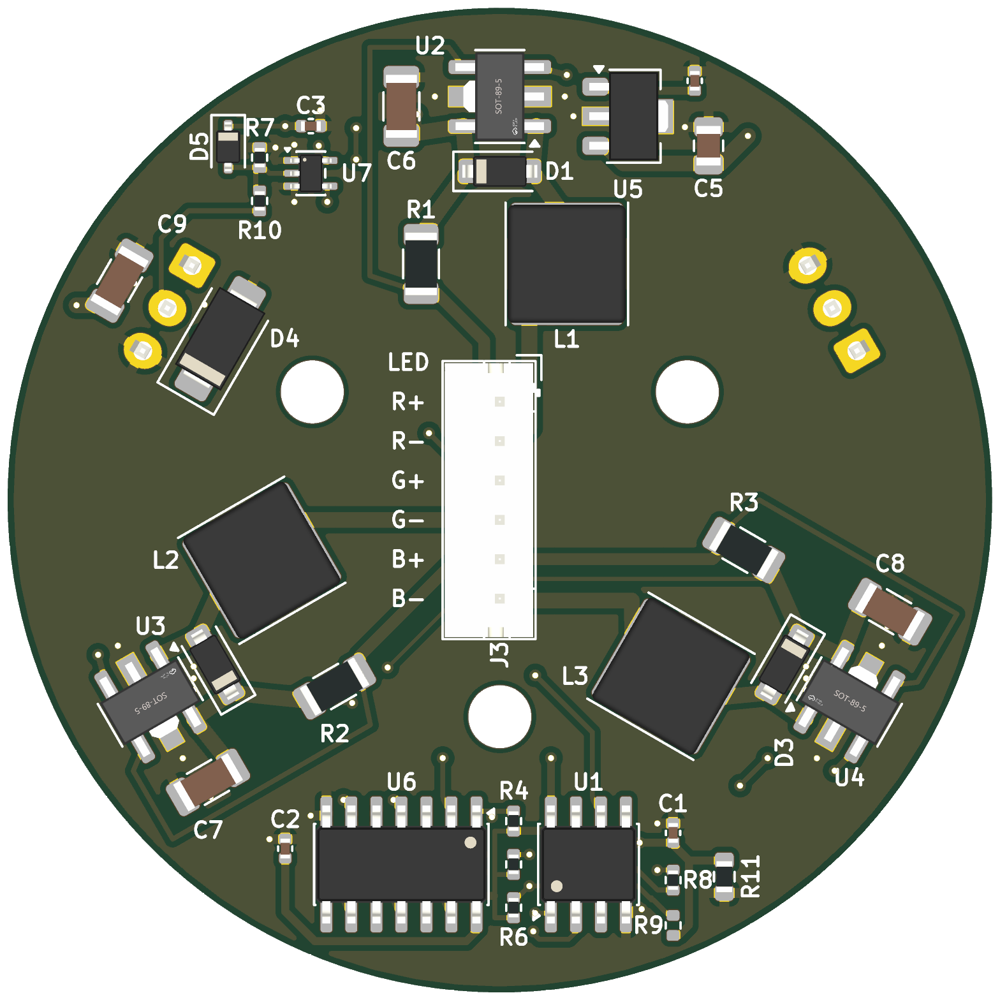
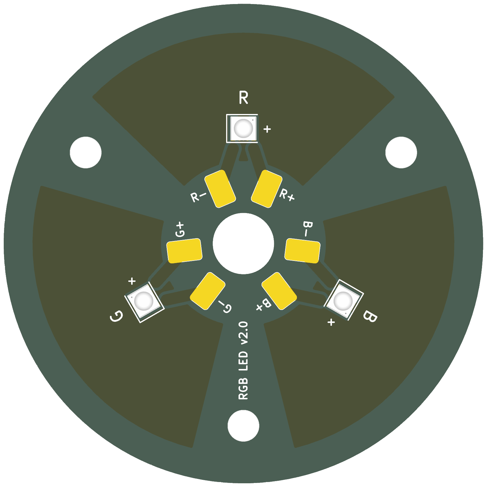

# Order 2026-11-16-v2.0-first: driver and LED board v2.0, 2 of each assembled, with the round-6 housing for 5 lamps

Generated by `pcbkit production` from [order.toml](order.toml); edit that, not this.

| PCB | version | house | PCBs | assembled | status | order no. | price | note |
| --- | --- | --- | --- | --- | --- | --- | --- | --- |
| driver | [v2.0](../../../releases/driver/v2.0) | JLCPCB | 5 | 2 | draft (2026-11-16) |  | 39.26 USD |  |
| led | [v2.0](../../../releases/led/v2.0) | JLCPCB | 5 | 2 | draft (2026-11-16) |  | 47.64 USD |  |

## Tell the fab

- LED board: aluminium, 1 layer, 1.6 mm, 1 oz, 1 W/mK (the only conductivity JLC offers on 1-layer aluminium), 3000 V, white mask, black silkscreen, HASL with lead, JLC's mark removed, single PCBs
- LED board PCBA: Standard (Economic is not offered on aluminium), top side, 2 of 5 assembled, JLC's edge rails added (the board is under 70 mm), Confirm Parts Placement yes; assembly remark: 'LED1-LED3 (HD2525): cathode = pad 1, the side away from the package dot. The + on the silk marks the anode.'
- LED board BOM: 3/3 matched by LCSC number; JLC left LED3 (blue, C49237860) unticked at quantity 0 with 'The processing of this component is difficult', reviewed after ordering and charged extra only if an advanced option is needed. Ticked by hand
- Driver: FR4, 2 layers, 1.6 mm, 1 oz, green mask, white silkscreen, HASL with lead (JLC now defaults to OSP), tented vias, JLC's default 0.3 mm via option (all 69 vias are 0.3 mm drills), JLC's mark removed. PCB remark: the JLCJLCJLCJLC text on the bottom silk is an old order-number placeholder, to be left off
- Driver PCBA: Economic, top side, 2 of 5 assembled, JLC's tooling holes, Confirm Parts Placement yes, nitrogen reflow (Economic default); files are the -front pair from `pcbkit fab` on the v2.0 board (the release's CPL less J1/J2, which sit on the back). J3 (JST PH 6, through-hole) placed by JLC: hand-soldering fee $3.61 and manual assembly $0.20
- Placement preview, checked part by part against the releases' PLACEMENT-*-jlcpcb.md: U2-U5 (^SOT-89, never checked before), U1/U6 (SOIC), D1-D4 right. Turned by hand: U7 (74AHCT1G125, C350557) one Rotate Left, as the never-checked ^SOT-353 (+180) left it a quarter turn out; LED2 and LED3 (green C49237859, blue C49237860) half a turn, as JLC draws them opposite the red (C49237857) on the same footprint. pcb-kit's table is fixed on branch jlc-rotations-spotlight
- Housing: JLCCNC sheet metal, Al 5052, black matte powder coat on shell, cap, hood, doors and yoke, plate/fins/spacers bare; the plate's 10 x M3 threads and the cap's 4 press nuts by drawing (mech/housing/order6/*.pdf), priced after JLCCNC's review. Carriers: JLC3DP MJF PA12-HP, dyed black
- Customs: boards 'Research/Education/DIY, DIY - HS 902300'; sheet metal HS 761699; carriers 'Plastic Bracket' HS 392690

## Notes

- LED polarity: settled on a v1 board on 2026-11-16. The user's diode test lit v1's LED1 (C49237857) with + on the L1 pad (pad 2) and - on the R1 pad (pad 1, GND side): pad 1 is the cathode, as the v2 footprint and D19's silk have it. All three datasheets (XL-HD2525SURC/UGC/UBC-A4) draw pad 1 as the cathode and the package dot by pad 2.
- Smallest assembled run: 2 of each board. Five lamps need 5 assembled of each; the remaining PCBs can be assembled in a second order once the first two have passed bring-up.
- Hand assembly: J1/J2 (JST B3B-XH-A, back of the driver) on both assembled drivers. Snap JLC's edge rails off the LED boards.
- Housing quotes need JLCCNC's manual review (2-4 h): the threads and press nuts are not in the cart prices yet.

## Upload

Each board's files are in `upload/<pcb>/` (rebuilt by `pcbkit production` while the order is open, not committed), taken from the pinned release.

- JLCPCB: PCB, the Gerber zip with the settings above; PCB Assembly, the BOM and CPL (`-jlcpcb`), the side the CPL places. Check the parts list, then the placement preview: rotations and polarity (diodes, LEDs, transistors, each IC's pin 1).
- PCBWay: PCB, the same Gerber zip; assembly, the BOM and centroid (`-pcbway`). PCBWay buys the parts by manufacturer part number: check its quote's parts list.
- Once placed: an `[[event]]` in order.toml (status `submitted`, `order_no`, `price`), then `pcbkit production`.

### driver 2.0.0 at JLCPCB

- PCB: `GERBER-driver-v2.0.zip`, 5 boards, 2 assembled
- Assembly: `BOM-driver-v2.0-jlcpcb.csv`, `CPL-driver-v2.0-jlcpcb.csv`
- Placed parts: 35 (20 part numbers), about 1.81 USD a board, 7 Extended

### led 2.0.0 at JLCPCB

- PCB: `GERBER-led-v2.0.zip`, 5 boards, 2 assembled
- Assembly: `BOM-led-v2.0-jlcpcb.csv`, `CPL-led-v2.0-jlcpcb.csv`
- Placed parts: 3 (3 part numbers), about 0.79 USD a board, 3 Extended

## Extras

Bought with the order, not placed on a board: spares and rework parts. On hand is what stock.toml has left after the boards above and the extras listed before.

| part | qty | on hand | to buy | where | why |
| --- | --- | --- | --- | --- | --- |
| B3B-XH-A(LF)(SN) (JST), 3-pin XH vertical | 4 | 0 | 4 | LCSC C144394 | driver J1, J2 on the back, 2 per assembled board; buy a few spare |
| Housing sheet metal for 5 lamps (round 6) | 1 | 0 | 1 | JLCCNC, in the JLC cart (SMS2611163003158 ... SMS2611163003204) | shell x5, cap x5, hood x5, door x20, yoke x5 (black powder coat); plate x5, fin x20, spacer x40 (bare): $156.95 before threads and press nuts |
| Optic carrier, MJF PA12 dyed black | 7 | 0 | 7 | JLC3DP, in the JLC cart (D2026111615500272, -280, -287) | 5 standard, 1 at +0.5 mm and 1 at +1.0 mm for the focus test: $26.65 |

## Events

| date | boards | status | order no. | price | note |
| --- | --- | --- | --- | --- | --- |
| 2026-11-16 | all | draft |  |  | files from the v2.0 releases (releases/driver/v2.0, releases/led/v2.0, pcbkit release on a9f73e7, commit cba9fda): ERC 0, DRC 0 with parity, 0 unconnected. Driver uploaded with `pcbkit fab`'s -front BOM/CPL (identical to the release's less J1/J2); LED board with the release's files |
| 2026-11-16 | led | draft |  | 47.64 USD | LED board v2.0 in the JLC cart: PCB Y172-2642684A ($4.00) and Standard PCBA SMT026111662959-2642684A ($43.64: setup 25.75, stencil 8.27, parts 3.94 for 3 lines, feeder loading 4.65, SMT 0.08, placement check 0.45, packaging 0.50; the assembly remark priced after review). Silkscreen in JLC's viewer: 'RGB LED v2.0'. Placement preview: LED1 right; LED2 and LED3 turned 180 by hand (JLC's + was on pad 1). Afterwards each LED's - hovered at pad 1 (LED1 148.4, -88.0; LED2 140.1, -106.9; LED3 161.4, -104.2) |
| 2026-11-16 | driver | draft |  | 39.26 USD | driver v2.0 in the JLC cart: PCB Y173-2642684A ($4.00, HASL with lead, 24 h) and Economic PCBA SMT026111662992-2642684A ($35.26: setup 8.24, stencil 1.55, parts 4.43 for 19 lines, Extended 15.45 (5 types), SMT 0.47, placement check 0.45, hand-soldering 3.61 and manual assembly 0.20 for J3, nitrogen 0.86). BOM 19/19 matched by LCSC number. Silkscreen 'RGB Spotlight driver v2.0'. Placement preview: pin-1 dots hovered on pad 1 for U1 (2.6, -21.8), U2 (2.1, 19.1), U3 (-17.5, -7.7), U4 (15.4, -11.2), U5 (4.7, 21.0), U6 (-1.2, -15.1); D1-D4 cathode marks on pad 1. U7 turned +90 by hand (pin 1 was at -8.9, 18.0; after, -10.6, 17.3) |
| 2026-11-16 | all | draft |  |  | the whole order in one cart: boards $86.90 + sheet metal $156.95 + carriers $26.65 = $270.50; DHL $98.36 for 5.23 kg, JLC coupon -$6.00: $362.86, ships about 2026-11-22 (boards alone: $86.90 + $26.97 - $6.00 = $107.87). Thread and press-nut charges come after JLCCNC's review. Nothing paid; all lines left unticked |
